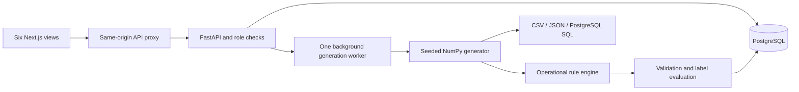
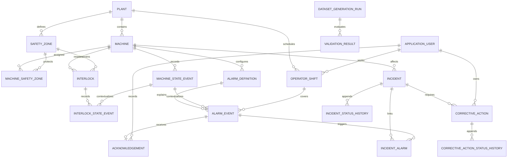

# Architecture and relationships

SafeOps is a local monorepo. The Next.js App Router renders six operational views. Same-origin `/api` requests are proxied to FastAPI. Pydantic validates requests; SQLAlchemy transactions write PostgreSQL. Alembic creates the schema and immutable-history triggers. The shared generator has no database or wall-clock dependency. No Docker, external AI service, queue server or cloud account is required.

An alarm has zero or one acknowledgement (a database unique constraint prevents competing responses). Machines and zones, and incidents and alarms, are many-to-many through explicit bridges. Other relationships are one-to-many. There are no required one-to-one relationships.

Every operational entity carries a `workspace_id`: `manual` or a deterministic simulation ID. Dataset generation creates a new namespace, or reuses an identical completed configuration. There is no destructive replacement endpoint. The UI includes manual records in operational lists; validation resolves references such as manual acting users without importing unrelated datasets. This prevents regeneration from overwriting manual records. Failed background generations roll back all data and retain a failed run with the error. The administrator may retry the same failed configuration. Restarting the API marks interrupted jobs failed rather than falsely reporting completion.

Configuration revisions close the old `[effective_from, effective_to)` interval and create a new immutable reference. Historical alarm definitions, state events and interlock evidence continue pointing to the original version. Restriction text describes the supported rule: mandatory guards must be closed and interlocks engaged during operation. It is not an arbitrary executable policy language.

Event occurrence, ingestion, acknowledgement, completion and verification are distinct timestamp fields. All use PostgreSQL timestamp with time zone. Timeline ordering uses occurrence time followed by canonical ID. Database triggers reject updates/deletes on alarms, acknowledgements, state events, lifecycle histories and audits. Current incident/action status is mutable only with an accompanying history event. A database owner can alter triggers; this is auditable application history, not tamper-proof regulatory storage.

Pagination, SQL window-based source deduplication and server-side SQL aggregates keep 50,000-event datasets out of browser memory. Source and filtering columns are indexed. Database writes are bulked in batches of 2,000. The single-process background executor is appropriate for this local demonstration; durable multi-worker scheduling is an explicit future deployment concern.
